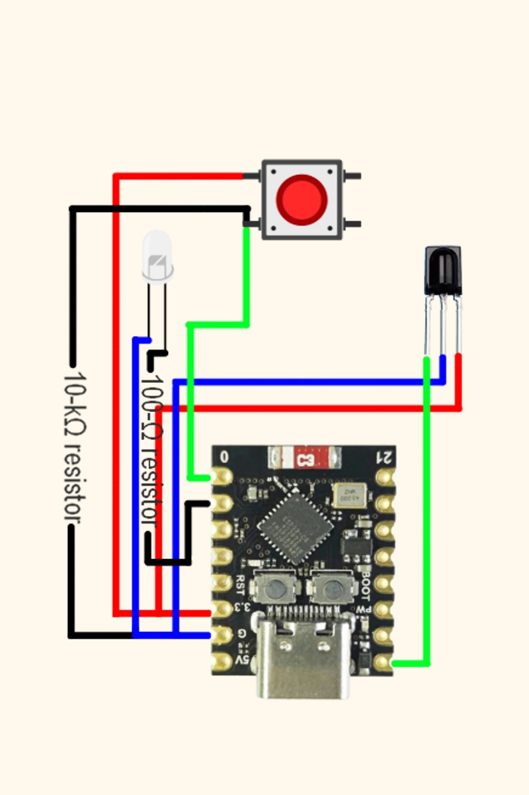

# IR Memorizer and Emitter

Capture an infrared (IR) signal from a remote control and retransmit it using an IR LED at the press of a button.

## Materials

- 1× 170-point breadboard
- 1× ESP32-C3 SuperMini
- 6× jumper wires
- 1× VS1838B IR receiver
- 1× 5 mm, 940 nm IR emitter LED
- 1× 100 Ω resistor
- 1× 10 kΩ resistor
- 1x 4-pin tactile push button

## Wiring Diagram

**Pin-to-pin connections shown for clarity; built and tested on a 170-point breadboard**

## Instructions

1. Wire the ESP32-C3 SuperMini according to the wiring diagram above.
2. Connect the ESP32-C3 SuperMini to your computer via USB.
3. Set the upload speed and Serial Monitor baud rate to **115200**.
4. Set USB CDC On Boot to enabled.
5. Ensure that the IRremote library by Armin Joachimsmeyer et al. is installed and ESP32 support is added to your IDE.
6. Select `Nologo ESP32C3 Super Mini` as your Board.
7. Select the appropriate port.
8. Flash the code located in `code/ir-receiver-emitter`.
9. Point an IR remote control at the receiver and press a button. The ESP32 should blink to indicate that a signal has been captured and stored. If connected to your computer, the captured code will also be printed in the Serial Monitor.
10. Press the button to retransmit the stored IR signal using the emitter.

## Behavior Notes
- Current code only supports NEC, Samsung, and Sony protocols.
- Memorized code is stored in RAM, causing the button not to emit anything after the microcontroller loses power.
